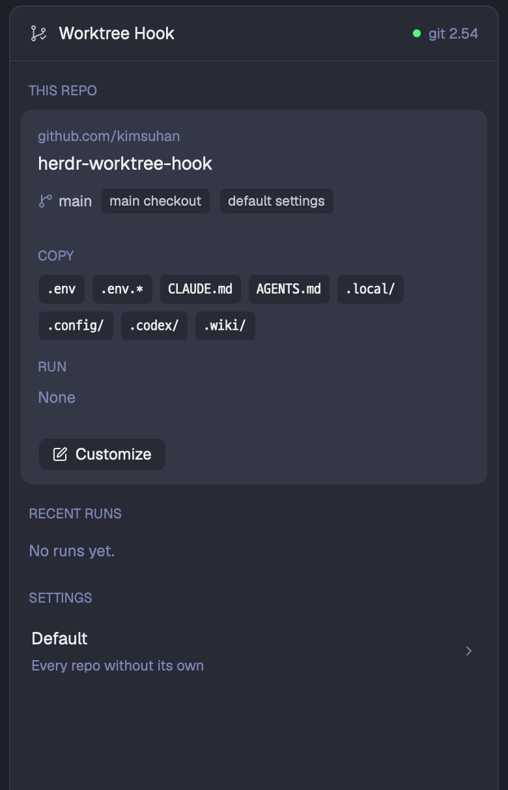

# Worktree Hook

A side panel for [herdr-worktree-hook](https://github.com/kimsuhan/herdr-worktree-hook), the git hook
that sets up every new worktree: it copies files such as `.env` from the main checkout and runs setup
commands such as `yarn install` in the background. The panel shows what a new worktree of the shown
space's repo gets, lets you change it per repo or for every repo, sets a worktree up again, and lists
recent runs with their logs. A failed run posts a notification.



## Before you add it

The panel is the face of the `herdr-worktree-hook` CLI (python3, git 2.54 or newer). Install it first,
or the panel shows only an error:

```sh
git clone https://github.com/kimsuhan/herdr-worktree-hook
mkdir -p ~/.local/bin && ln -s "$PWD/herdr-worktree-hook/bin/herdr-worktree-hook" ~/.local/bin/
herdr-worktree-hook install     # the global post-checkout hook
```

The mod **runs programs**: `herdr-worktree-hook` for every read and write, and `sh` to pipe JSON into
it. It **reads files outside its folder**: the run logs under
`~/.local/state/herdr/plugins/kimsuhan.worktree-hook/runs/`. It reaches no network and writes no file
itself.

## What you see

A card filling its block: `rounded(10)`, 1px `border`, `background`, 13px text in `foreground`.
Top to bottom:

- **Header**, 42px, 14px side padding, bottom border: the mod's icon (15px, `muted`), "Worktree Hook"
  (semibold), then at the right in 11px a 6px dot and "git 2.54" (`ansi2` dot, `dim` text) or
  "not installed" (both `blocked`). In the form view a 26px `‹` button (`chevron-left`, `hover`
  background) replaces the icon.
- **Banner**, only while the hook isn't in git config: `blocked` at 13% alpha (`+ "22"`), 12px text
  "The git hook isn't installed: new worktrees aren't set up." wrapping beside a solid `Install` button.
- **Error line**, only when the CLI failed: a `rounded(7)` block, 8px margin, `ansi1` at 11% alpha
  (`+ "1c"`), 12px `ansi1` text.
- **Body**, scrolling, either the list or the form.
  - **List.** Section labels in 10.5px semibold `dim` caps, 14px above and 6px below:
    - `THIS REPO`: one `raised` card (8px margin, `rounded(9)`, 1px `border`), three parts split by
      1px `border` lines, 12px side padding:
      - the key in two lines, "github.com/org" in 11px `dim` over "repo" in 14px semibold; under it a
        row with the `git-branch` icon and the branch in 11.5px `muted`, then two pills (10.5px,
        `rounded(5)`, `background` with a `border`): "worktree" or "main checkout", and
        "default settings" or, tinted `accent` (`+ "22"` fill, `+ "44"` border), "own settings";
      - `COPY`, `RUN` and, only when it has any, `SKIP RUN`, each a 10.5px semibold `dim` label over its
        values in the terminal font (`settings().font_family`) at 11px: paths and patterns as wrapping
        chips (`background`, `border`, `rounded(5)`), commands as one `background` block with a `dim`
        number before each line. "None" in 12px `dim` when empty;
      - buttons, 26px high, `background` with a `border` and a `hover` background so they stand out on
        `raised`: `Customize` (no settings of its own) or `Edit`, with the `square-pen` icon, and
        `Set up again` only in a linked worktree.
      Instead of the card, 12px `dim` text says "Spaces on other machines aren't supported yet." or
      "The shown space isn't in a git checkout."
    - `RECENT RUNS`: the shown repo's runs (every repo's when the space isn't in a git checkout), up
      to 30 rows, newest first, 8px margin, 8×6 padding, `hover` background (kept
      while its log is open): a 7px dot (`ansi2` ok, `ansi1` failed, `dim` lost) or, while running, the
      spinner in `working`; the branch (or the worktree's folder name when detached) over
      "repo · 5m ago" in 11px `dim`; at the right the status in the dot's color ("ok", "running",
      "lost", or "exit 1"), then a `dim` chevron, right when closed and down when open.
      Empty: "No runs yet."
    - `SETTINGS`: a row for "Default" ("Every repo without its own" under it) and one per repo that has
      its own entry, other than the one above: the repo name over "github.com/org · " and its commands
      joined by " && ", or "copy only". Each ends in a `dim` `chevron-right`.
  - **Form.** "github.com/org" in 11px `dim` over the repo name in 15px semibold, or just
    "Default settings". An 11px `dim` hint: "An empty field follows the default settings, shown in
    grey." (for `default`: "...keeps the built-in value...").
    Then `COPY`, `RUN`, `SKIP RUN`, each a 10.5px label, a textarea (`raised`, 8px padding, `input`
    border, terminal font at 12px, growing from 2 to 10 rows) and an 11px `dim` help line. Placeholders
    show the value it would inherit, one per line. A problem shows in 12px `ansi1`. At the bottom,
    `Reset to default` at the left (`ansi1` text and border, only when the key has an entry; the first
    click turns it into `Confirm reset`), `Cancel` and a solid `Save` at the right.

## How it behaves

- Follows where the shown space is working: the folder of its focused terminal, else of the terminal
  last focused in it, else of its first terminal, else the space's own folder, else home. Switching
  spaces, or focusing a terminal in another checkout, shows that repo. Agent statuses don't change
  anything here.
- Clicking a run row opens its log under it on a `raised` block with a `border`: the `folder` icon and
  the worktree path (`~/...`) in 11px `dim`, a line, then the last 80 lines of the log in the terminal
  font, 11px `muted` ("(empty log)" when there's none). Clicking again closes it.
- `Customize`, `Edit` and a `SETTINGS` row open the form for that key. Each field is filled with the
  key's own value only; `Save` leaves out empty fields, so they follow `default` (or the built-in
  `.env`, `.env.*`), and goes back to the list. A field the CLI or the file saved as an empty list
  (a repo turning the default's commands off) shows "(none)" and stays an empty list while it's left
  empty; `Reset to default` is how to drop it. `Cancel` and `‹` go back without saving.
- `Reset to default`, then `Confirm reset`, removes the entry the form is editing (any repo's, or
  `default`) and goes back to the list.
- `Set up again` runs the copy and the commands for the shown worktree now. `Install` registers the
  hook. Any of them failing shows the CLI's message in the error line.
- A run that fails after the panel opened posts a notification: "Worktree setup failed: <branch>",
  body "exit 1 · <repo key>", level error, whichever repo it's in: the list is filtered, the
  notifications aren't. Runs that had failed before it opened don't.
- Changes made elsewhere (the CLI, editing `config.json`, a new worktree) show up by themselves.

## Built from

- One mod, `mods/worktree-hook/`: `main.js`, `mod.json` (`{ "place": "right", "size": 340 }`) and
  `worktree-hook.svg`, a 24×24 stroked icon (two commits on a branch line, a third off to the side, a
  check mark) for a tab bar button. No layout and no keys.
- `gpui-kit` (`View`, `div`, `svg`), `gpui-base` (`v_flex`, `h_flex`, `TextareaState`, `Textarea`).
- `herdr`: `exec`, `home`, `theme`, `settings`, `spaces`, `panes`, `focused`, `notify`,
  `readTextFile`, `watchFolder`.
- Art: besides its own icon, Herdr's from the shipped `mods/workspace-chrome/`: `git-branch`,
  `square-pen`, `folder`, `chevron-left`, `chevron-right`, `chevron-down`, and `spinner` with
  `.spin(900)` while a run is going.
- The CLI, all JSON on stdout:
  - `version`: is it on PATH;
  - `ls`: `{config, state, installed, git, builtin, default, repos}`;
  - `history --json -n 100` (all the CLI keeps): runs `{id, repo, path, branch, status, exit, started, log}`;
  - `show <folder>`: `{key, top, main, linked, branch, own, entry}`, `entry` being the settings in effect;
  - `set <key>` (JSON on stdin), `rm <key>`, `run <worktree>`, `install`.
  A failure exits nonzero with `herdr-worktree-hook: <message>` on stderr; show the message without
  the prefix.

## Watch out

- `exec` has no stdin: save with `exec("sh", ["-c", 'printf %s "$2" | "$1" set "$3"', "sh", bin, json, key])`.
- Find the CLI once at start: `herdr-worktree-hook version` on PATH, else `~/.local/bin/herdr-worktree-hook`.
  If neither works then, the panel keeps the error until it reloads.
- Watch the folder of `ls`'s `config` and its `state` folder with `watchFolder` and reload on each
  change, then `cx.sleep(1000)`: a run writing its log is a stream of changes. A folder that doesn't
  exist yet rejects the watch, so poll every 5 seconds instead.
- `Confirm reset` belongs to the open form: keep the flag on the form's state, not on the view, or it
  outlives the entry it was clicked for.
- A space's `folder` is only where it was made; a worktree opened in it later is found through its
  terminals' `cwd`. Clicking the panel takes the focus away from the terminal, so remember the last
  focused folder per space. Two `show` calls can answer out of order: drop the older answer.
- The shown space changes without a command: compare its folder in `render` and fetch `show` only
  when it differs, or every render starts another `exec`.
- Spaces on another machine (`space.machine`) are not supported: the CLI and its files are local.
- The mod only reads and edits; copying and running happen in the git hook, outside Herdr.

## Done when

- `herdr-app check` passes.
- Without the hook in git config, the banner shows; `Install` makes it go and the header says
  "git 2.54" (or newer).
- In a space inside a git repo, `THIS REPO` shows its `origin` key and `.env`, `.env.*` under `copy`;
  in a space at home it says the space isn't in a git checkout.
- `Customize`, a line `echo hi` under `RUN`, `Save`: the block says "own settings" and `run` shows
  `echo hi`; `herdr-worktree-hook show` agrees.
- `git worktree add` in that repo adds a `RECENT RUNS` row that turns from the spinner to a green
  "ok"; clicking it shows `$ echo hi` and `hi`.
- A `RUN` of `false` makes the next worktree's row red "exit 1" and posts the notification.
- `Edit`, `Reset to default`, then `Confirm reset`: back to the list, which says "default settings".
